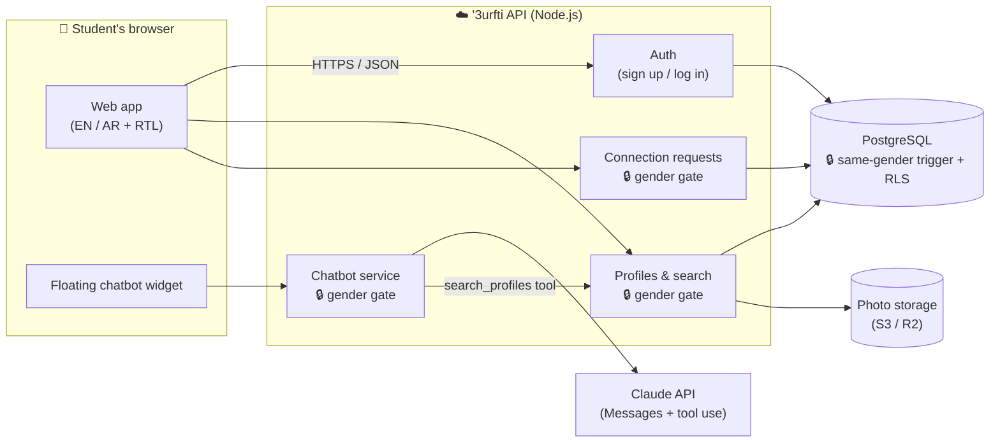
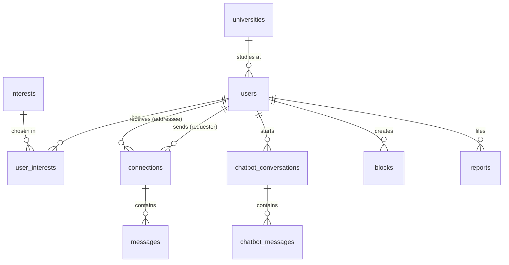
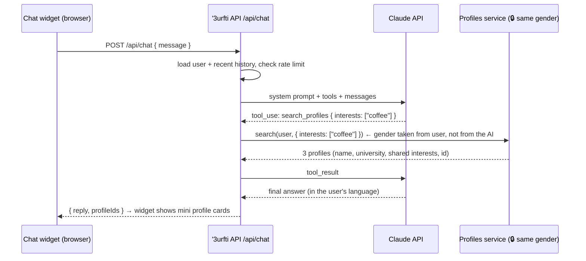

# '3urfti (غرفتي) — Full-Stack Architecture Blueprint

> **'3urfti** helps Arab college students find compatible roommates, make friends in their area, and connect near their campus.
> The name is Arabizi for **غرفتي** — "my room".

This document describes the **real, production version** of the app. The files in this folder are a working **front-end prototype** of it (see §10 for how the two relate).

---

## 1. The big picture



| Layer | Prototype (this folder) | Production |
|---|---|---|
| Frontend | HTML + Tailwind CSS (CDN) + plain JavaScript | Next.js (React) + Tailwind CSS (compiled) + `next-intl` |
| Backend | none — `localStorage` pretends to be the database | Node.js + Express (or NestJS), TypeScript |
| Database | `localStorage` | PostgreSQL (Supabase or Neon) |
| Auth | SHA-256 hash in the browser (demo only) | Argon2id password hashes, httpOnly session cookie, university-email verification |
| Chatbot | Rule-based helper in the browser | Backend endpoint → Claude API with tool use |
| Hosting | Open the `.html` file | Vercel (web) + Render/Fly.io (API) + managed Postgres + Cloudflare R2 (photos) |

---

## 2. Frontend architecture

### Pages / routes

| Route | Who can see it | Purpose |
|---|---|---|
| `/` | everyone | Landing page: headline, description, **Sign Up** / **Log In** |
| `/signup` (modal) | guests | 2-step onboarding: *About you* → *Campus & interests* |
| `/login` (modal) | guests | Email + password (plus demo accounts in the prototype) |
| `/discover` | logged-in users | Discovery Dashboard: filters, profile cards, profile modal, chatbot |
| `/requests` | logged-in users | Incoming / outgoing connection requests *(next step)* |
| `/messages` | logged-in users | Chat with accepted connections *(next step)* |

### Components (React names for production; matching sections exist in the prototype)

```
<AppShell>                 top bar: logo, language toggle, requests badge, user menu
  <LanguageToggle/>        flips EN ⇄ AR, sets <html lang dir>, saves the choice
  <DiscoverPage>
    <FilterPanel/>         looking-for (top), search, college year, budget range + currency, university + major (type-to-search), 🔒 locked gender, interest chips
    <ResultsGrid>
      <ProfileCard/>       avatar, name, college year, major, university, match %, interests, [View] [Ask to Connect]
    </ResultsGrid>
    <ProfileModal/>        full details, shared interests highlighted, big [Ask to Connect]
    <ConnectButton/>       states: idle → pending (→ accepted / declined)
  </DiscoverPage>
  <ChatbotWidget/>         floating button + chat panel + quick-reply chips
</AppShell>
```

### Bilingual + RTL

* Every visible string lives in one dictionary per language (`en`, `ar`). Elements reference strings by key (`data-i18n="hero.desc"` in the prototype, `t("hero.desc")` in React).
* Switching to Arabic sets `<html lang="ar" dir="rtl">`. The whole layout mirrors automatically because the CSS uses **logical** directions — Tailwind's `ms-*`, `me-*`, `ps-*`, `pe-*`, `start-*`, `end-*`, `text-start` — instead of `left` / `right`.
* Arabic text uses the **Cairo** font; English uses **Inter**.
* The chosen language is saved (in `localStorage` now, in `users.preferred_lang` later) and the chatbot replies in that language.

---

## 3. Database schema (PostgreSQL)

```sql
-- ---------- Types ----------
CREATE TYPE gender_t            AS ENUM ('female', 'male');
CREATE TYPE looking_for_t       AS ENUM ('roommate', 'friends', 'both');
CREATE TYPE college_year_t      AS ENUM ('y1', 'y2', 'y3', 'y4', 'y5', 'grad');
CREATE TYPE connection_status_t AS ENUM ('pending', 'accepted', 'declined', 'canceled');

-- ---------- Reference data ----------
CREATE TABLE universities (
  id            SERIAL PRIMARY KEY,
  slug          TEXT UNIQUE NOT NULL,          -- 'kuniv'
  name_en       TEXT NOT NULL,                 -- 'Kuwait University'
  name_ar       TEXT NOT NULL,                 -- 'جامعة الكويت'
  city          TEXT,
  country_code  CHAR(2),
  email_domain  TEXT                           -- used to verify student emails
);

CREATE TABLE interests (
  id       SERIAL PRIMARY KEY,
  slug     TEXT UNIQUE NOT NULL,               -- 'coffee'
  name_en  TEXT NOT NULL,
  name_ar  TEXT NOT NULL,
  emoji    TEXT
);

-- ---------- Users ----------
CREATE TABLE users (
  id                 UUID PRIMARY KEY DEFAULT gen_random_uuid(),
  email              CITEXT UNIQUE NOT NULL,
  password_hash      TEXT NOT NULL,            -- argon2id, never the real password
  full_name          TEXT NOT NULL,
  gender             gender_t NOT NULL,        -- set once at sign-up; users cannot edit it
  college_year       college_year_t NOT NULL,  -- 'y1' freshman … 'y4' senior, 'y5' 5th year+, 'grad'
  university_id      INT NOT NULL REFERENCES universities(id),
  major              TEXT,
  bio                TEXT CHECK (char_length(bio) <= 500),
  looking_for        looking_for_t NOT NULL DEFAULT 'both',
  preferred_lang     CHAR(2) NOT NULL DEFAULT 'en' CHECK (preferred_lang IN ('en', 'ar')),
  avatar_url         TEXT,
  email_verified_at  TIMESTAMPTZ,
  is_active          BOOLEAN NOT NULL DEFAULT true,
  created_at         TIMESTAMPTZ NOT NULL DEFAULT now(),
  updated_at         TIMESTAMPTZ NOT NULL DEFAULT now(),
  budget_min         INT CHECK (budget_min >= 0),   -- monthly rent budget (optional)
  budget_max         INT CHECK (budget_max >= budget_min),
  budget_currency    CHAR(3) DEFAULT 'KWD',         -- ISO code: KWD, SAR, GBP, USD…
  custom_university  TEXT                      -- the college name they typed when it isn't in `universities`
);
CREATE INDEX users_discover_idx ON users (gender, university_id) WHERE is_active;

CREATE TABLE user_interests (
  user_id      UUID REFERENCES users(id) ON DELETE CASCADE,
  interest_id  INT  REFERENCES interests(id),
  PRIMARY KEY (user_id, interest_id)
);
CREATE INDEX user_interests_interest_idx ON user_interests (interest_id);

-- ---------- Connections ----------
CREATE TABLE connections (
  id            UUID PRIMARY KEY DEFAULT gen_random_uuid(),
  requester_id  UUID NOT NULL REFERENCES users(id) ON DELETE CASCADE,
  addressee_id  UUID NOT NULL REFERENCES users(id) ON DELETE CASCADE,
  status        connection_status_t NOT NULL DEFAULT 'pending',
  note          TEXT CHECK (char_length(note) <= 200),
  created_at    TIMESTAMPTZ NOT NULL DEFAULT now(),
  responded_at  TIMESTAMPTZ,
  CHECK (requester_id <> addressee_id),
  UNIQUE (requester_id, addressee_id)
);

CREATE TABLE messages (                        -- only for accepted connections
  id             UUID PRIMARY KEY DEFAULT gen_random_uuid(),
  connection_id  UUID NOT NULL REFERENCES connections(id) ON DELETE CASCADE,
  sender_id      UUID NOT NULL REFERENCES users(id),
  body           TEXT NOT NULL CHECK (char_length(body) <= 2000),
  created_at     TIMESTAMPTZ NOT NULL DEFAULT now(),
  read_at        TIMESTAMPTZ
);

-- ---------- Safety ----------
CREATE TABLE blocks  (blocker_id UUID REFERENCES users(id), blocked_id UUID REFERENCES users(id),
                      created_at TIMESTAMPTZ DEFAULT now(), PRIMARY KEY (blocker_id, blocked_id));
CREATE TABLE reports (id UUID PRIMARY KEY DEFAULT gen_random_uuid(),
                      reporter_id UUID REFERENCES users(id), reported_id UUID REFERENCES users(id),
                      reason TEXT NOT NULL, status TEXT NOT NULL DEFAULT 'open',
                      created_at TIMESTAMPTZ DEFAULT now());

-- ---------- Chatbot history ----------
CREATE TABLE chatbot_conversations (
  id          UUID PRIMARY KEY DEFAULT gen_random_uuid(),
  user_id     UUID NOT NULL REFERENCES users(id) ON DELETE CASCADE,
  created_at  TIMESTAMPTZ NOT NULL DEFAULT now()
);
CREATE TABLE chatbot_messages (
  id               BIGSERIAL PRIMARY KEY,
  conversation_id  UUID NOT NULL REFERENCES chatbot_conversations(id) ON DELETE CASCADE,
  role             TEXT NOT NULL CHECK (role IN ('user', 'assistant')),
  content          JSONB NOT NULL,             -- full content blocks, kept unchanged
  created_at       TIMESTAMPTZ NOT NULL DEFAULT now()
);
```



---

## 4. Backend API (REST, JSON)

All routes except auth + reference data need a logged-in session cookie.

| Method & path | What it does |
|---|---|
| `POST /api/auth/register` | Create account (name, email, password, gender, birth date, university, interests, looking-for) |
| `POST /api/auth/login` · `POST /api/auth/logout` | Start / end a session |
| `GET /api/me` · `PATCH /api/me` | Read / edit own profile — **`gender` is rejected in PATCH** |
| `GET /api/universities` · `GET /api/interests` | Lists for the forms (both languages) |
| `GET /api/profiles?q&ageMin&ageMax&university&interests&lookingFor&page` | Discovery search — **gender comes from the session, never from the query** |
| `GET /api/profiles/:id` | One profile — returns **404** if it is a different gender (doesn't even reveal it exists) |
| `POST /api/connections` `{ addresseeId, note? }` | "Ask to Connect" |
| `GET /api/connections?box=incoming\|outgoing` | Request lists |
| `PATCH /api/connections/:id` `{ status: accepted\|declined }` | Respond to a request (addressee only) |
| `DELETE /api/connections/:id` | Cancel own pending request |
| `POST /api/blocks` · `POST /api/reports` | Safety tools |
| `POST /api/chat` `{ conversationId?, message }` | Chatbot (see §7) |

Extra rules: rate-limit `POST /api/connections` (e.g. 30/day) and `POST /api/chat` (e.g. 20/min); hide blocked users in both directions; never send `email` or `password_hash` to other users.

---

## 5. 🔒 Gender separation — enforced in three layers

The rule: **a student only ever sees, is matched with, or can connect with students of the same gender.** It is not a filter the user can turn off.

| Layer | How it is enforced |
|---|---|
| **1. Database** | `connections` has a trigger that refuses any row between different genders. Row-Level Security on `users` only returns rows of the viewer's gender. |
| **2. API** | Every profile query adds `WHERE gender = session.user.gender` on the server. Any `gender` sent by the browser is ignored. A different-gender profile id returns 404. The chatbot's `search_profiles` tool uses the same function. |
| **3. Interface** | The Gender filter is shown **locked** to the user's own gender with a 🔒 icon and a short explanation. Sign-up explains that gender cannot be changed later. |

```sql
-- Layer 1a: no cross-gender connection can ever be stored
CREATE FUNCTION enforce_same_gender() RETURNS trigger AS $$
BEGIN
  IF (SELECT gender FROM users WHERE id = NEW.requester_id)
     IS DISTINCT FROM
     (SELECT gender FROM users WHERE id = NEW.addressee_id) THEN
    RAISE EXCEPTION 'Connections are only allowed between users of the same gender';
  END IF;
  RETURN NEW;
END $$ LANGUAGE plpgsql;

CREATE TRIGGER connections_same_gender
  BEFORE INSERT OR UPDATE ON connections
  FOR EACH ROW EXECUTE FUNCTION enforce_same_gender();

-- Layer 1b: reading the users table only returns your own gender
CREATE FUNCTION current_user_gender() RETURNS gender_t
  LANGUAGE sql STABLE SECURITY DEFINER AS $$
  SELECT gender FROM users WHERE id = current_setting('app.user_id')::uuid
$$;

ALTER TABLE users ENABLE ROW LEVEL SECURITY;
CREATE POLICY same_gender_only ON users FOR SELECT
  USING (gender = current_user_gender());
```

Gender changes are handled only by the support team after identity verification, and they reset existing connections.

---

## 6. Matching score

Used to sort results and by the chatbot. Same formula in the prototype (`js/dashboard.js → matchScore`).

```
shared   = interests both students picked
overlap  = shared / (all different interests the two students picked)     ← 0 … 1
score    = 40
         + 45 × overlap
         + 10  if same university
         +  4  if their goals fit (both want a roommate, both want friends, or either picks "both")
score    = min(score, 99)   → shown as "87% match"
```

Later improvements: lifestyle questions (sleep schedule, tidiness, guests, smoking), budget range and move-in date for roommate seekers, and learning from which requests get accepted.

---

## 7. Chatbot architecture

**Roles:** onboarding concierge (explains the app), roommate-matching assistant (suggests real profiles), housing FAQ (rent, contracts, roommate agreements, safety).



**Key design choices**

* **The API key never reaches the browser.** The widget only talks to `/api/chat`.
* **Gender rule is outside the AI.** The tool function receives the logged-in user from the server and applies the same `WHERE gender = …` as the dashboard. The AI cannot ask for other genders because the tool has no gender parameter.
* **Only safe fields go to the model:** first name, college year, university, major, interests, looking-for. Never email, phone or exact location.
* **Language:** the system prompt tells the model to answer in `user.preferred_lang` (Arabic or English) and to match the user if they switch.
* **Housing knowledge** lives in the system prompt (short, reviewed list of tips). Later it can move into a searchable FAQ table.
* **Storage:** each turn's full content blocks are saved to `chatbot_messages` so the conversation can continue.

**Model choice:** `claude-opus-5-5` with `effort: "low"` (fast, inexpensive replies for chat). Server-side **refusal fallbacks** are switched on, so if a safety check declines a message the API automatically retries on a fallback model.

**Sketch of the endpoint (Node.js, `@anthropic-ai/sdk`)**

```js
import Anthropic from "@anthropic-ai/sdk";

const client = new Anthropic(); // reads ANTHROPIC_API_KEY from the server's environment

const tools = [
  {
    name: "search_profiles",
    description:
      "Find students the current user is allowed to see, ranked by match score. " +
      "Gender separation is applied automatically by the server.",
    input_schema: {
      type: "object",
      properties: {
        interests:   { type: "array", items: { type: "string" }, description: "Interest slugs, e.g. ['coffee','gaming']" },
        university:  { type: "string", description: "University slug, e.g. 'kuniv'" },
        looking_for: { type: "string", enum: ["roommate", "friends", "both"] },
        limit:       { type: "integer", minimum: 1, maximum: 5 },
      },
      additionalProperties: false,
    },
  },
];

app.post("/api/chat", requireAuth, rateLimit("chat"), async (req, res) => {
  const user = req.user;                                   // from the session cookie
  const messages = await loadHistory(user.id, req.body.conversationId);
  messages.push({ role: "user", content: req.body.message });

  for (let step = 0; step < 5; step++) {                   // cap the tool loop
    const response = await client.beta.messages.create({
      model: "claude-opus-5-5",
      max_tokens: 16000,
      output_config: { effort: "low" },
      betas: ["server-side-fallback-2026-07-01"],
      fallbacks: "default",
      system: buildSystemPrompt(user),                     // role, rules, housing tips, reply language
      tools,
      messages,
    });

    messages.push({ role: "assistant", content: response.content });

    if (response.stop_reason === "refusal") {
      return res.json({ reply: politeFallback(user.preferred_lang) });
    }
    if (response.stop_reason !== "tool_use") {
      await saveHistory(user.id, messages);
      const reply = response.content.filter(b => b.type === "text").map(b => b.text).join("");
      return res.json({ reply });
    }

    const results = [];
    for (const block of response.content) {
      if (block.type !== "tool_use") continue;
      // 🔒 the gender rule comes from `user`, never from the model's input
      const profiles = await searchProfiles(user, block.input);
      results.push({ type: "tool_result", tool_use_id: block.id, content: JSON.stringify(profiles) });
    }
    messages.push({ role: "user", content: results });
  }
  res.json({ reply: politeFallback(user.preferred_lang) });
});
```

**System prompt outline:** who '3urfti is for → what the helper can do → "always answer in {Arabic|English}" → "only suggest people returned by `search_profiles`; never invent students" → "never share contact details; encourage meeting in public places" → short housing tips list → "if asked about seeing other genders, explain the rule kindly".

---

## 8. Security & privacy checklist

* Passwords: Argon2id; sessions in httpOnly + Secure + SameSite cookies; CSRF protection on forms.
* Verify the student email domain of the chosen university before a profile appears in search.
* Minimum age 17; no exact addresses — only university / area.
* Block + report on every profile; reports reviewed by moderators; repeated reports auto-hide a profile.
* Rate limits on sign-up, log-in, connection requests and chatbot.
* Store only what is needed; allow account deletion (cascade deletes); follow local data-protection law (e.g. Kuwait CITRA data-privacy regulation, Saudi PDPL, UAE PDPL).
* Escape all user-written text when showing it (the prototype does this with `escapeHtml`).

---

## 9. Roadmap

1. **Prototype (this folder)** — landing page, onboarding, dashboard, filters, profile modal, Ask to Connect, rule-based helper. ✅
2. **Backend v1** — Postgres + API from §3–§5, real sign-up/log-in, move `Store` calls to `fetch()` calls.
3. **AI helper** — `/api/chat` from §7 replaces the rule-based `getReply()` in `js/chatbot.js`.
4. **Requests & messages** — accept/decline, 1-to-1 chat (WebSockets) for accepted connections.
5. **Housing extras** — budget, move-in date, lifestyle quiz, listings near campus.

---

## 10. Prototype file map

| File | Role |
|---|---|
| `index.html` | Landing page + Sign Up / Log In modals |
| `dashboard.html` | Discovery Dashboard + profile modal + chatbot panel |
| `css/styles.css` | Small custom styles (fonts, chips, animations) |
| `js/tailwind-config.js` | '3urfti brand colours for Tailwind |
| `js/i18n.js` | All English + Arabic text, the language toggle, RTL switch |
| `js/data.js` | Universities, interests and 24 sample students |
| `js/store.js` | Pretend database in `localStorage` (users, session, connections) |
| `js/ui.js` | Shared helpers: modals, toast, avatars, icons |
| `js/auth.js` | Landing page logic: onboarding steps, validation, log in |
| `js/dashboard.js` | Filters, cards, profile modal, Ask to Connect, 🔒 gender gate |
| `js/chatbot.js` | Floating helper: intents, match suggestions, housing answers |
